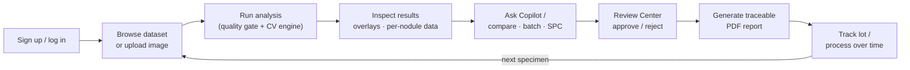
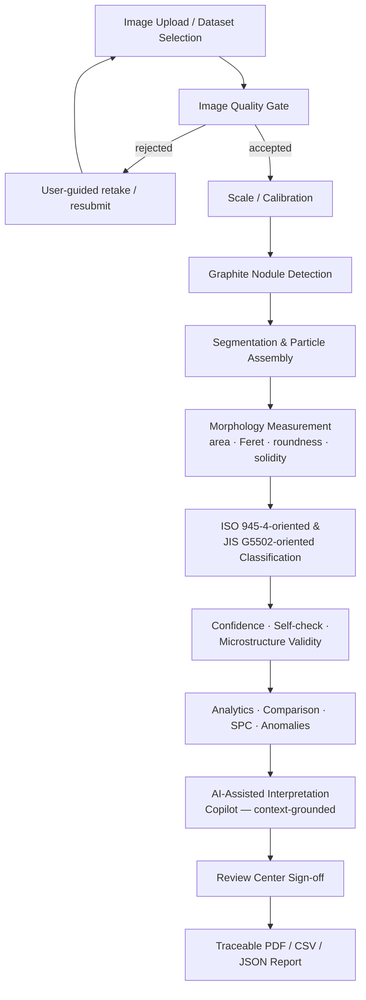
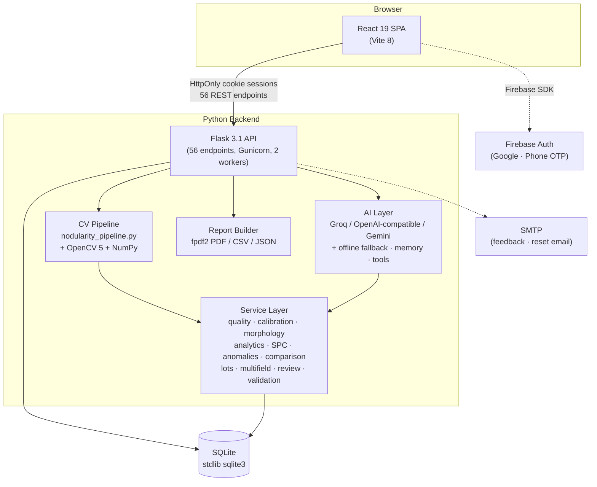

# NODIQ-X

## AI-Powered Microstructure Intelligence

> **Transform cast-iron microstructure images into measurable, interpretable and traceable metallurgical insight.**

| | |
|---|---|
| **Product** | NODIQ-X |
| **Category** | Industrial Computer Vision · Metallurgical Decision Support |
| **Product Status** | Functional prototype / decision-support platform (production-hardened codebase; scientific validation in progress) |
| **Document Type** | Product Requirements Document (PRD) |
| **Version** | 1.0 |
| **Last Updated** | 2026-09-21 |
| **Domain** | Ductile (spheroidal-graphite) cast iron quality analysis |

---

## 2. Executive Summary

NODIQ-X is a web-based metallurgical analysis platform that turns photographs of cast-iron microstructures into **measured, classified and traceable quality information**. A user uploads a micrograph — or selects one from a 1,000-image validated dataset — and NODIQ-X detects graphite particles, measures each particle's morphology, computes **ISO 945-4-oriented nodularity** (area-weighted) and **JIS G5502-oriented nodularity** (class-count-weighted), assigns a graphite-form classification, runs self-checks, and produces a downloadable PDF report.

The platform exists because manual microstructure evaluation is slow, subjective and inconsistently documented. Nodule counting by eye differs between analysts; nodularity percentages vary with fatigue, magnification and judgment; and results often live in scattered spreadsheets with no link back to the original image. NODIQ-X replaces that workflow with a deterministic computer-vision pipeline whose every number is derived from a stored, re-examinable analysis record — image, per-particle measurements, calibration, quality gate, validation status and report all stay connected.

NODIQ-X serves **quality engineers, metallurgists, foundry teams, laboratory analysts, researchers and students**. Beyond single-image analysis it provides multi-field ISO sampling sessions, batch processing, statistical process control (SPC), anomaly screening, analysis comparison, lot acceptance tracking, an expert Review Center for sign-off, and an AI Copilot that explains measured results in plain language — always grounded in the actual stored measurements, never in invented metallurgy.

Three design principles distinguish the product: **the CV engine is the single source of measurement truth** (the AI layer can explain but never fabricate numbers); **validation and expert judgment stay central** (results carry confidence, self-checks and review status; the system never claims certification); and **scientific honesty is a feature** (accuracy claims are limited to what repository evidence actually supports — see §12 and §22).

---

## 3. Problem Statement

Ductile iron quality hinges on graphite **nodularity** — the proportion of spheroidal graphite particles in the microstructure. Measuring it today is largely manual:

- **Manual counting is slow.** An analyst visually counts and classifies hundreds of graphite particles per field of view, one micrograph at a time.
- **Interpretation is subjective.** Two trained analysts — or the same analyst on two days — can disagree on whether an irregular particle "counts" as nodular. ISO 945-4 acknowledges this by prescribing geometric roundness criteria precisely so judgment can be replaced by measurement.
- **Workflows are inconsistent.** Field selection, magnification, threshold judgment and border handling vary between laboratories and between engineers, undermining repeatability.
- **Traceability is fragmented.** Results land in spreadsheets and slide decks, decoupled from the source image, the calibration used, and who reviewed them.
- **Comparison is hard.** Comparing batches, shifts or suppliers means reconstructing history by hand; early warning of a drifting process is mostly luck.
- **Reporting is copy-paste.** Turning an image into a customer-ready, traceable report is an hour of formatting per analysis.

The gap is not a lack of microscopy — it is the absence of a **repeatable bridge between the raw image and decision-grade, documented quality information**. That bridge is what NODIQ-X builds.

---

## 4. Product Vision

```text
Image  →  Measurement  →  Interpretation  →  Validation  →  Decision Support  →  Traceable Report
```

NODIQ-X's vision is a laboratory where **every micrograph becomes a measurement, every measurement becomes an interpretation, every interpretation is validated, and every validated result becomes a traceable report** — without the analyst ever surrendering judgment to the software.

The platform is explicitly positioned as an **intelligent analysis and decision-support system**, not a replacement for metallurgical experts. The engine produces numbers; the AI Copilot explains them; the Review Center lets qualified people approve, reject or annotate them; and the report records who did what. Where evidence is incomplete, NODIQ-X says so — in the product, in its reports, and in its documentation.

---

## 5. Target Users

| User | Needs | NODIQ-X Value |
|---|---|---|
| **Quality Engineer** | Repeatable, documented inspection with sign-off | Automated ISO/JIS-oriented measurement, quality gate, Review Center approval trail |
| **Metallurgist** | Detailed particle-level morphology and form data | Per-nodule measurements (roundness, Feret size, solidity), graphite-form classification, overlays |
| **Foundry Engineer** | Batch and shift-level process monitoring | Batch statistics, SPC control charts, anomaly screening, lot acceptance tracking |
| **Laboratory Analyst** | Fast single-image throughput | Upload → analyze → report in one pass; 1,000-image dataset for quick reference work |
| **Researcher** | Reproducible, exportable measurements | Deterministic pipeline, per-particle CSV/JSON export, comparison engine, multi-field sessions |
| **Student / Academic User** | Learning and safe experimentation | Free dataset access, visual overlays, Copilot explanations, no paid dependencies |
| **Reviewer / Supervisor** | Verify before results go to customers | Review Center with approve/reject status and recorded reviewer identity |

---

## 6. User Problems & Jobs To Be Done

The typical journey a user takes through the product:



**Quality Engineer**
> **When** I receive micrographs from production, **I want** the nodularity measured the same way every time, **so that** I can accept or reject batches on documented, defensible numbers instead of opinion.

**Metallurgist**
> **When** I examine an unusual microstructure, **I want** per-particle geometry and graphite-form classification with visual overlays, **so that** I can investigate morphology without hand-drawing contours on prints.

**Foundry Engineer**
> **When** I track a casting line over weeks, **I want** SPC charts and anomaly alerts on nodularity, **so that** I catch process drift before it becomes scrap.

**Laboratory Analyst**
> **When** I have a queue of images, **I want** upload-analyze-report to take minutes, **so that** throughput does not bottleneck the lab.

**Researcher**
> **When** I run experiments, **I want** deterministic per-particle exports and analysis comparison, **so that** my results are reproducible and quantifiable.

**Reviewer / Supervisor**
> **When** a report is about to leave the lab, **I want** a recorded approve/reject step with my name on it, **so that** accountability and review are part of the record.

**Student**
> **When** I learn about nodularity, **I want** to pick dataset images and get instant, explained results, **so that** I can connect the standard's formulas to real micrographs.

---

## 7. Product Goals

- **Reduce manual analysis effort** — automate particle detection, measurement and classification end-to-end for a single micrograph.
- **Improve repeatability** — the same image yields the same numbers: a deterministic classical-CV pipeline with fixed thresholds, no stochastic inference.
- **Make every measurement transparent** — each headline value (count, ISO %, JIS %) is derivable from stored per-particle rows; nothing is a black box.
- **Preserve traceability** — image → analysis → results → quality/calibration → review → report, all linked by analysis IDs and recorded user identity.
- **Support standards-oriented methodology** — implement ISO 945-4 roundness and JIS G5502 class weighting exactly as documented, labeled as *oriented*, not certified.
- **Enable batch-level intelligence** — aggregates, distributions, SPC and anomaly screening across many analyses.
- **Provide validation workflows** — internal, blind, synthetic and external validation lanes plus human sign-off.
- **Keep the platform honest** — never display an accuracy claim the evidence does not support; surface `GROUND_TRUTH_UNAVAILABLE` rather than inventing numbers.

---

## 8. Non-Goals

NODIQ-X is **not** intended to:

- ❌ **Replace qualified metallurgists** — it quantifies and explains; humans validate and decide.
- ❌ **Certify material or issue conformity certificates** — formal conformity additionally depends on specimen preparation, acquisition, calibration traceability and field selection, which software alone cannot verify.
- ❌ **Claim universal industrial accuracy** — no independent expert ground truth exists yet; accuracy against real micrographs is explicitly `GROUND_TRUTH_UNAVAILABLE` in the product's own benchmark output.
- ❌ **Replace laboratory standards or procedures** — it *supports* ISO 945-4/JIS G5502 methodology; it does not substitute for standard-controlled workflows.
- ❌ **Make material-property predictions** (e.g., tensile strength) — morphology measurement and reference-knowledge explanation only.
- ❌ **Act as a legal record of conformity** — reports are decision-support documents, not certification artifacts.
- ❌ **Replace the microscope** — image quality gates exist precisely because acquisition quality still belongs to the lab.

---

## 9. Core Product Workflow



**Stage by stage:**

1. **Image Upload** — drag-and-drop or selection of JPG/PNG (≤ 25 MB), or one-click analysis of any of 1,000 dataset micrographs. Uploads pass strict validation: MIME sniffing, magic-byte checks, randomized server-side filenames, path-traversal protection.
2. **Image Quality Gate** — the engine scores blur/sharpness (Laplacian-based), RMS contrast, illumination uniformity, clipping/over-exposure, noise, saturation and resolution *in the same pass as analysis*. Poor images are flagged or rejected before any nodularity value is trusted.
3. **Scale / Calibration** — manual µm/px entry or automatic scale-bar detection. Without a valid physical scale, sub-10 µm size filtering reports **`not_evaluable`** — the system never fabricates a calibration.
4. **Graphite Nodule Detection** — a frozen **classical CV hybrid** (no ML checkpoint): median + Otsu thresholding with a size floor, robust background-subtraction detection, candidate merging, evidence-based validation and refinement of suspicious candidates.
5. **Segmentation / Particle Assembly** — contour extraction, joined-particle consolidation, blob ownership recovery, and a blob-map consistency gate before aggregates are computed.
6. **Morphology Measurement** — per particle: area, maximum Feret diameter, roundness η = 4A/(π·l²), solidity, aspect; plus border-touching flags.
7. **ISO/JIS-oriented Classification** — spheroidal if η ≥ 0.6 (ISO 945-4 §3.3); JIS buckets with upper-inclusive 0.2/0.4/0.7/0.8 boundaries; area-weighted ISO and count-weighted JIS aggregates (§11).
8. **Confidence / Validation** — accuracy self-check against an internal Otsu reference, microstructure-validity verdicts (`valid` / `not_sure` / `invalid`), advisory warnings, and optional multi-field sampling status against the ISO 5-field / 500-particle targets.
9. **Analytics / Comparison** — batch statistics, distributions, SPC control charts, anomaly screening, and pairwise analysis comparison.
10. **AI-Assisted Interpretation** — the Copilot receives the *measured* context and explains it; guardrails force it to cite stored numbers and refuse to invent metallurgy.
11. **Review / Sign-off** — approve, reject or annotate with reviewer identity recorded.
12. **Traceable Report** — PDF (fpdf2), CSV or JSON with measurements, quality, calibration, batch context, SPC snapshot and review status — every artifact linked to its analysis ID.

---

## 10. Core Features

### 10.1 Authentication & Session Management — `IMPLEMENTED`

**Purpose:** identify users, isolate their data, protect every record-writing route.

**Current status:** fully implemented and regression-tested (bcrypt hashing with legacy-PBKDF2 upgrade path, HttpOnly cookie sessions, server-side revocation).

**Key capabilities**
- **Email + password** signup/login with bcrypt; login/signup rate limiting
- **Google sign-in** (Firebase popup flow)
- **Phone authentication** (Firebase SMS OTP with reCAPTCHA) — requires Firebase Blaze plan for real SMS
- **Password reset** via emailed reset tokens (separate token family from sessions; secrecy preserved)
- **HttpOnly, Secure, SameSite=Lax session cookies** (7-day Max-Age); tokens never exposed to JavaScript
- **Backend Firebase ID-token verification** before any account linkage; per-user ownership isolation on every record
- **Session history** (device/IP/session list) and logout with server-side revocation

### 10.2 Image Quality Gate — `IMPLEMENTED`

**Purpose:** stop unsuitable micrographs from producing meaningless nodularity numbers.

**Key capabilities** (services/quality.py, scored during the analysis pass):
- Sharpness/blur (Laplacian variance), RMS contrast, illumination uniformity
- Over/under-exposure clipping, noise estimate, saturation check
- Resolution adequacy, text/graphics artifact heuristic
- Quality report attached to every analysis; retrieval via `/api/quality/<id>`
- Suitability verdict feeds the microstructure-validity check (rejected specimens never yield trusted nodularity)

### 10.3 Microstructure Analysis Engine — `IMPLEMENTED`

**Purpose:** the deterministic CV core that produces all measurements.

**Current status:** the production engine is a **classical CV hybrid** (Otsu/median detection, contour assembly, consistency gates). A **Detectron2/ML detector path is not part of the shipped pipeline** — no model checkpoint exists in the repository.

**Key capabilities**
- Graphite particle detection with candidate merge/refinement and evidence-based validation
- Per-particle: **area, perimeter, maximum Feret diameter, roundness, solidity, aspect ratio, border-touch flag**
- Nodule count with unification/recovery handling of divided and joined particles
- Self-check accuracy score against an internal Otsu reference (labeled as internal agreement, *not* expert accuracy)
- Annotated overlay + binary/contour masks returned per analysis
- Analysis record persisted with per-nodule rows, retrievable via `/api/analyses/<id>/nodules`

### 10.4 Nodularity Measurement (ISO & JIS Views) — `IMPLEMENTED`

**Purpose:** the headline quality numbers, standards-oriented and fully derived.

**The actual implemented formulas** (verified in nodularity_pipeline.py):

- **Roundness (ISO 945-4:2019 §3.2):** η = 4A / (π · l²), where *A* = particle area, *l* = maximum Feret diameter
- **Spheroidal particle (ISO 945-4 §3.3):** η ≥ 0.6 (normative threshold)
- **ISO-oriented nodularity (area-weighted, headline):** `Σ area(η ≥ 0.6) / Σ area(all) × 100`
- **ISO in-frame (strict Formula-2 analogue):** same ratio with border-touching particles removed from *both* terms — the standards-aligned value
- **JIS-oriented nodularity (count-weighted):** `(0.3·N₂ + 0.7·N₃ + 0.9·N₄ + 1.0·N₅) / N_all × 100`, with JIS buckets upper-inclusive at 0.2/0.4/0.7/0.8

The UI presents both **ISO view** and **JIS view** so users see that the two standards weight particles differently (area vs. class counts). Border handling is explicit and documented in the report.

### 10.5 Graphite Morphology Classification — `IMPLEMENTED`

**Purpose:** form-level classification beyond the two headline percentages.

**Key capabilities** (services/morphology.py): dominant graphite-form classification from per-particle geometry (matrix hints from dominant form, count share and area share); per-particle ISO class labels (`V/VI` vs. irregular) and JIS bucket assignments; size-distribution stats in physical units when calibrated.

### 10.6 Scale Calibration — `IMPLEMENTED`

**Purpose:** connect pixels to micrometres without ever inventing a scale.

**Key capabilities** (services/calibration.py): manual µm/px with validation bounds; automatic scale-bar detection (text-label + solid-bar heuristics); calibration stored per analysis; size filtering (<10 µm exclusion) applied **only** with valid calibration — otherwise `not_evaluable`; physical-unit size statistics in reports.

### 10.7 Multi-Field Sessions (ISO Sampling Framework) — `IMPLEMENTED`

**Purpose:** standards-aligned sampling beyond a single field of view.

**Key capabilities** (services/multifield.py): sessions holding multiple fields, each with its own analysis, metrics and calibration; aggregates computed on **underlying areas** (ISO) and **class counts** (JIS) — never an average of percentages; explicit sampling status against ISO 945-4's ≥5 fields / ≥500 particles targets; uncalibrated fields excluded with an explained status.

### 10.8 Batch Analysis — `IMPLEMENTED`

**Purpose:** process many images as one quality population.

**Key capabilities** (services/analytics.py): multi-image processing from the Batch Analysis page; aggregate batch statistics with accept-threshold classification; per-metric distributions and histograms; per-image drill-down into the same analysis records used everywhere else.

### 10.9 Analytics & SPC — `IMPLEMENTED`

**Purpose:** turn stored analyses into process intelligence.

**Key capabilities**: batch statistics with acceptance thresholds; SPC control limits (x̄ chart with control limits and trend detection — increasing/stable/decreasing) computed from stored nodularity series; distribution analysis by metric; user-scoped history endpoints powering the Analytics dashboard.

### 10.10 Anomaly Screening & Decision Support — `IMPLEMENTED`

**Purpose:** flag unusual results before they become customer escapes.

**Key capabilities** (services/anomalies.py): per-analysis anomaly assessment against the user's history; history-wide scan; **decision-support endpoint** that combines anomalies, batch context and SPC into actionable guidance; surfaced on the Anomalies page and inside the Copilot context.

### 10.11 Compare — `IMPLEMENTED`

**Purpose:** quantify differences between two analyses.

**Key capabilities** (services/comparison.py): pairwise comparison of nodularity metrics, irregular fraction, mean roundness, size statistics and size distributions between any two user-owned analyses, presented on the Compare page.

### 10.12 Lots (Traceable Batches) — `IMPLEMENTED`

**Purpose:** group analyses into production lots with acceptance status.

**Key capabilities** (services/lots.py): lot assignment per analysis; lot summaries with accept/reject against a configurable nodularity threshold; lot listing per user; shown on the Lots page and linked from analysis records.

### 10.13 Validation & Review Center — `IMPLEMENTED` (engine) / `IMPLEMENTED` (sign-off)

**Purpose:** keep human judgment and self-testing central.

**Key capabilities**:
- **Review Center:** approve/reject/annotate analyses with reviewer identity and comment recorded; status visible on analyses and reports
- **Validation Lab** (services/validation_lab.py): four separated lanes — `INTERNAL` (self-consistency), `BLIND` (sampled blind tests), `SYNTHETIC` (generated micrographs with known ground truth), `EXTERNAL` (user-supplied expert-annotated paths) — runnable from Settings
- **Confidence/uncertainty surface:** self-check score, validity verdicts, advisory warnings attached to every analysis

### 10.14 AI Copilot — `IMPLEMENTED`

**Purpose:** an interpretation/decision-support layer over measured results.

**Current status:** fully wired to real providers with guardrails; *not* an autonomous metallurgy authority.

**Key capabilities** (ai/): multi-provider LLM backend — **Groq (default, llama-3.3-70b), OpenAI-compatible, Gemini, plus an offline deterministic fallback**; API-key rotation queue; streaming responses; server-side chat memory per session; capability registry with tool allowlist; context built **only** from the user's actual analysis records (contract, quality, calibration, batch, SPC, anomalies); guardrails force context-grounded numbers and refuse invented metallurgy; image-attach flow analyzes via the CV engine first, then the Copilot explains the measured result; reference knowledge base of project-authored metallurgy topics.

> **Positioning:** the Copilot helps users *understand* measurements, trends, quality indicators and report findings. It does not independently prove metallurgical conclusions, and it cannot override the CV engine's numbers.

### 10.15 Reports — `IMPLEMENTED`

**Purpose:** turn validated results into shareable, traceable documents.

**Key capabilities** (report_builder.py + Reports pages): report configuration (section selection: executive summary, quality assessment, analysis results, image evidence, charts & statistics, confidence & uncertainty, AI interpretation, human validation); metadata (title, sample ID, engineering notes); **PDF generation via fpdf2** plus CSV/JSON export; report preview; evidence endpoints serving analysis images/overlays into reports; batch context and SPC snapshots embedded; review status recorded; download endpoints with ownership checks.

### 10.16 Sessions & History — `IMPLEMENTED`

**Purpose:** a navigable record of everything the user has done.

**Key capabilities:** authentication-session history (device/IP) *and* analysis sessions; My Analyses list with stats; per-analysis deep views (nodules, context, overlays, quality, calibration); full ownership isolation.

### 10.17 Platform & Trust Features — `IMPLEMENTED`

- **Dataset library:** 1,000-image micrograph dataset browsable/searchable in-app, with per-image prior analysis retrieval
- **Landing page:** product presentation with the login video preserved as part of the experience
- **Light/dark mode,** professional typography, motion design
- **Feedback system** with email delivery (SMTP-configurable)
- **Legal pages:** Privacy and Terms
- **Health endpoint** (`/api/health`) reporting engine readiness (1,000/1,000 dataset images)

---

## 11. Scientific & Measurement Layer

This is the product's core. Everything below is **verified in the repository** (nodularity_pipeline.py, services/*).

### 11.1 What is measured, per particle

| Measurement | Method |
|---|---|
| Area | contour area (cv2) |
| Maximum Feret diameter | max pairwise hull-point distance |
| Roundness η | 4A / (π · l²) |
| Perimeter | contour perimeter |
| Solidity | area / convex-hull area |
| Aspect ratio | from geometry |
| Border flag | contour touches frame edge |

### 11.2 The implemented equations

**Roundness (ISO 945-4:2019 clause 3.2):**

```text
η = 4A / (π · l_m²)

A   = particle area (px², or µm² when calibrated)
l_m = maximum Feret diameter (largest point-to-point distance
      across the particle's convex hull)
```

**Spheroidal classification (ISO 945-4 clause 3.3):** a particle is spheroidal when **η ≥ 0.6** — the normative threshold.

**ISO 945-4-oriented nodularity (headline, area-weighted):**

```text
ISO% = Σ area(η ≥ 0.6) / Σ area(all particles) × 100
```

**ISO in-frame (strict Formula-2 analogue):** identical ratio computed after removing border-touching particles from **both** numerator and denominator. Border clipping lowers measured roundness, so the product reports both values and explains the difference.

**JIS G5502-oriented nodularity (count-weighted):**

```text
JIS% = (0.3·N₂ + 0.7·N₃ + 0.9·N₄ + 1.0·N₅) / N_all × 100

N_k = number of particles in JIS class k
Classes (upper-inclusive roundness boundaries):
  class 1: η ≤ 0.2 (weight 0) · class 2: ≤ 0.4 (0.3)
  class 3: ≤ 0.7 (0.7) · class 4: ≤ 0.8 (0.9) · class 5: > 0.8 (1.0)
```

**Multi-field aggregation (ISO sampling framework):** the multi-field ISO value is computed from **summed underlying areas**, and the multi-field JIS value from **summed class counts** — never an average of per-field percentages. Sampling status is reported against ISO 945-4's ≥ 5 fields / ≥ 500 particles targets.

### 11.3 Detection & pipeline integrity

- **Frozen classical-CV hybrid detector:** median + Otsu with size floor (800 px² at 1920 px working width), robust background-subtraction detection, candidate merging, suspicious-candidate refinement, evidence-based validation, joined-particle consolidation and blob-ownership recovery — followed by a blob-map **consistency gate** before any aggregate is computed.
- **Working width 1920 px** (linear resize) for scale-consistent measurement.
- **Annotation-overlay hygiene:** the engine detects and strips pre-existing annotation/graphics overlays so captions and arrows in source images don't corrupt detection.
- **Microstructure-validity gate:** `evaluate_microstructure_validity` can reject a specimen (verdicts: valid / not_sure / invalid) before nodularity is trusted.

### 11.4 Calibration & physical units

Manual and automatic (scale-bar detection) calibration produce a µm/px value validated against realistic bounds. Physical size filtering (sub-10 µm exclusion) and physical-unit size statistics are applied **only** when calibration exists; otherwise the system reports **`not_evaluable`** — fabricating a scale is a design-level prohibition.

### 11.5 Standards positioning — read carefully

> **NODIQ-X is "ISO 945-oriented" and "JIS-oriented". It is not ISO-certified or JIS-certified, and no conformity claim is made.** Formulas were implemented against the published ISO 945-4:2019 clauses (3.2, 3.3, 6.3, 6.4) and the JIS G5502:2022 method, verified by the repository's own audit tests (`test_nodularity_audit.py`). Formal conformity additionally depends on specimen preparation, microscope acquisition, calibration traceability and field selection — factors software alone cannot certify.

---

## 12. Quality & Validation Strategy

NODIQ-X separates validation into four evidence tiers and reports each honestly:

### Tier 1 — Software correctness — `STRONG`
- **~270+ automated tests** (pytest): auth security, cookie sessions, ownership isolation, rate limiting (shared across workers), input validation, upload security, API contracts, multifield, size filter, key rotation, secrets hygiene, regression gate
- **39/39 ML-benchmark test suite**; deterministic release-candidate gate (rc_gate)
- 2-worker Gunicorn deployment verified by live smoke suite (23/23)

### Tier 2 — Algorithm evaluation (dataset-level) — `PARTIAL, HONESTLY REPORTED`
- Accuracy benchmark framework (services/accuracy_bench.py) with per-image, per-particle, error-analysis and threshold-analysis outputs
- The benchmark's own summary reports **`GROUND_TRUTH_UNAVAILABLE`**: precision/recall/F1 and nodularity MAE/RMSE are **null by design** because no independent expert ground truth exists
- Internal agreement is measured against an Otsu-based reference detector — labeled as internal consistency, **not** accuracy
- **Synthetic validation:** generated micrographs with known ground truth (counts, areas) validate the mechanics end-to-end

### Tier 3 — Expert validation — `WORKFLOW EXISTS, DATA PENDING`
- Validation Lab supports blind tests and external expert-annotated sets
- Review Center records human approve/reject with identity
- Ground-truth annotation tooling exists (tools/annotate_ground_truth.py) awaiting expert input

### Tier 4 — Real-world industrial validation — `NOT YET ESTABLISHED`
- No external laboratory inter-lab study has been performed
- This is the explicit gap between the working product and an industrially certified tool

> **Rule the product follows:** where evidence is incomplete, outputs say so. Reports and benchmarks print `GROUND_TRUTH_UNAVAILABLE` rather than a fabricated number.

---

## 13. Data & Traceability

Every artifact is user-scoped and linked:

```text
Image  ──▶ Analysis (ID)  ──▶ Results (per-particle rows)
              │                      │
              ├── Quality report ────┤
              ├── Calibration ───────┤
              ├── Review status ──────┤
              ▼                      ▼
        Lot / Session ──▶ Batch/SPC/Anomaly context ──▶ Report (ID)
```

| Artifact | Stored | Traceability |
|---|---|---|
| Source image | server-side (randomized filename) | retrievable per analysis |
| Analysis record | SQLite (`analyses`) | analysis ID, user ID, timestamp |
| Per-particle data | nodule rows | derivable aggregates |
| Quality gate result | attached to analysis | same engine pass |
| Calibration | `calibrations` table | per analysis |
| Multi-field session | `sessions` layer | field ↔ analysis links |
| Lot | lot ID on analyses | lot summaries |
| Review | status + reviewer + comment | per analysis |
| Report | `reports` table | references analysis + evidence |

**Chain:** Image → Analysis → Result → Validation → Report is fully navigable through the API; every download and evidence endpoint enforces ownership.

---

## 14. UX / Design Principles

NODIQ-X should feel like a **precision industrial instrument**: professional, technical, scientific, data-driven, trustworthy.

- **Clear data hierarchy** — headline numbers (nodule count, ISO %, JIS %, self-check accuracy) dominate; per-particle detail sits one level down
- **Microstructure visualization first** — annotated overlays and masks are first-class UI objects, with interactive per-nodule inspection and a professional roundness-distribution histogram (axes, gridlines, mean marker)
- **Light/dark mode** across the entire product
- **Professional typography** — technical/mono faces for measurements, clean UI faces for chrome
- **Motion & micro-interactions** — guided wizard for report generation (Select → Configure → Generate → Preview), analysis progress states, landing-page motion and the **preserved login video** (`/videos/nodiq-login-loop.mp4`)
- **Responsive dashboard experience** — sidebar navigation across all tool pages
- **Honest-state UI** — invalid micrographs, missing calibration and unavailable ground truth are *shown*, not hidden

---

## 15. Technical Architecture



| Layer | Technology (verified) |
|---|---|
| Frontend | React 19 + Vite 8, React Router, Firebase JS SDK |
| Backend | Flask 3.1 + Flask-CORS, Gunicorn (master + 2 workers) |
| Database | SQLite (stdlib `sqlite3`, no new dependency) |
| Computer Vision | OpenCV 5.0 + NumPy 2.4 — **classical CV, no ML checkpoint** |
| AI providers | Groq (default), OpenAI-compatible, Gemini, offline fallback |
| Auth | Firebase (Google, Phone) + bcrypt email/password; HttpOnly cookie sessions |
| Reporting | fpdf2 (PDF), CSV/JSON |
| Email | SMTP (feedback, password reset, SPC alerts) |
| Deployment | Docker + docker-compose, `TRUST_PROXY`-aware behind reverse proxy |

**Role separation enforced in code:** CV = measurement authority · analytics = evidence · AI = reasoning over stored facts.

---

## 16. Security Requirements

All measures below are **implemented and regression-tested** (docs/FINAL_SECURITY_REPORT.md):

- **Authentication:** bcrypt password hashing (with legacy-hash upgrade on login); Firebase ID tokens verified server-side before account linkage
- **Sessions:** **HttpOnly + Secure + SameSite=Lax cookies** (7-day Max-Age); tokens never readable by JavaScript; server-side revocation on logout/password change; JWT signing secret rotated via documented runbook
- **Authorization:** per-user ownership isolation on every record route (regression-tested: user A cannot read/modify user B's analyses, reports, sessions)
- **Rate limiting:** shared-across-workers limiter on all auth routes (stored in the shared SQLite DB)
- **Input validation:** strict server-side schema validation with unknown-field rejection; JWT-grammar validation for Firebase ID tokens; path-traversal protection on all file routes
- **Upload security:** 25 MB cap, MIME + magic-byte validation, randomized server filenames, extension allowlisting
- **Security headers:** enforced CSP (`default-src 'self'`; script-src allowlist incl. Firebase/reCAPTCHA/Google-sign-in hosts, exact-hash for Firebase bootstrap; `frame-ancestors 'none'`), HSTS behind trusted proxy
- **Secrets hygiene:** `.env` gitignored; placeholder-only `.env.example`; secret-scan tests; credentials never logged (security event logging is structured and secret-free)
- **Audit logging:** structured security event log (logins, failures, rejections, suspicious paths)

> NODIQ-X implements defense-in-depth as engineering practice. No security certification is claimed.

---

## 17. Functional Requirements

**Authentication & Accounts**
- **FR-001** — The system shall allow users to sign up and authenticate via email+password (bcrypt-hashed).
- **FR-002** — The system shall support Google sign-in and phone-OTP authentication through Firebase, verifying ID tokens server-side before session issuance.
- **FR-003** — The system shall maintain HttpOnly session cookies, support logout with server-side revocation, and provide password reset via emailed tokens.
- **FR-004** — The system shall isolate all user data by ownership; no route may expose another user's records.

**Image Intake**
- **FR-005** — The system shall accept JPG/PNG micrographs up to 25 MB via upload or dataset selection (1,000 images), validating MIME, magic bytes and filenames.
- **FR-006** — The system shall assess image quality (blur, contrast, illumination, exposure, noise, resolution, artifacts) and attach the assessment to every analysis.

**Analysis**
- **FR-007** — The system shall detect graphite particles and store per-particle measurements (area, perimeter, Feret, roundness, solidity, aspect, border flag).
- **FR-008** — The system shall compute nodule count, ISO-oriented nodularity (area-weighted, plus in-frame variant), and JIS-oriented nodularity (count-weighted) using the formulas in §11.2.
- **FR-009** — The system shall classify graphite forms and label each particle's ISO class and JIS bucket.
- **FR-010** — The system shall support manual and automatic scale-bar calibration, applying physical size filtering only when calibration is valid.
- **FR-011** — The system shall return annotated overlays and masks with each analysis and expose per-nodule inspection.
- **FR-012** — The system shall evaluate microstructure validity and flag unsuitable specimens instead of emitting untrustworthy nodularity.
- **FR-013** — The system shall support multi-field sessions aggregating underlying areas (ISO) and class counts (JIS) with explicit sampling status.

**Intelligence & Review**
- **FR-014** — The system shall provide batch statistics, distributions, SPC control charts and trend detection across a user's analyses.
- **FR-015** — The system shall screen analyses for anomalies and provide decision-support guidance grounded in measured data.
- **FR-016** — The system shall compare two user-owned analyses across nodularity, roundness, irregular fraction and size distributions.
- **FR-017** — The system shall support lot grouping with accept/reject summaries against a configurable threshold.
- **FR-018** — The system shall record expert review (approve/reject/annotate) with reviewer identity and expose validation status on analyses and reports.
- **FR-019** — The system shall provide an AI Copilot that answers questions using only stored, verified analysis context and offers image attach-and-explain.

**Reporting**
- **FR-020** — The system shall generate configured PDF/CSV/JSON reports with metadata, selected sections, quality, calibration, batch context, SPC snapshot, review status and evidence images.
- **FR-021** — The system shall provide report preview and download with ownership enforcement.

**Platform**
- **FR-022** — The system shall provide user-scoped session/analysis history with statistics.
- **FR-023** — The system shall expose health and AI-status endpoints and accept feedback with email delivery.
- **FR-024** — The system shall record security-relevant events in a structured, secret-free audit log.

---

## 18. Non-Functional Requirements

| Category | Requirement |
|---|---|
| **Performance** | Single-image analysis completes in the order of seconds (measured ≈ 9 s end-to-end incl. engine pass in local runs); API contract caching (300 s TTL by analysis ID) avoids recomputation |
| **Reliability** | Deterministic pipeline (no stochastic inference); candidate-recovery machinery for hard micrographs; invalid-input rejection over silent failure |
| **Security** | See §16 — HttpOnly sessions, CSP, rate limiting, ownership isolation, upload hardening, audit logging |
| **Usability** | Wizard-based report flow, light/dark mode, honest-state messaging, dataset browsing for zero-friction trials |
| **Reproducibility** | Same input → same output; per-particle export allows independent recomputation of every aggregate |
| **Traceability** | Full chain §13; every report linked to analysis, review and evidence |
| **Maintainability** | Layered services with single responsibilities; ~270-test regression suite; docs/ architecture records |
| **Scalability** | 2-worker Gunicorn verified; SQLite acknowledged as the current scaling ceiling (see §22) |

---

## 19. MVP Definition

### ✅ Implemented (verified in repository)

- Landing page, auth (email/Google/phone), HttpOnly cookie sessions, password reset
- New Analysis: upload or 1,000-image dataset, quality gate, full CV engine, ISO/JIS nodularity, overlays, per-nodule data
- Calibration (manual + auto scale-bar), size filtering with `not_evaluable` honesty
- Multi-field ISO sampling sessions
- Batch analysis, analytics dashboard, SPC, anomaly screening, decision support
- Compare, Lots, Sessions, My Analyses
- Review Center sign-off; Validation Lab (internal/blind/synthetic/external lanes)
- AI Copilot (Groq + fallbacks, streaming, memory, guardrails, image explain)
- Reports: configuration wizard, PDF/CSV/JSON, preview, downloads, evidence
- Security hardening per §16; ~270 passing tests; Docker production setup with 2-worker Gunicorn; 23/23 live smoke

### 🟡 Partially Implemented

- **Scientific accuracy evidence:** benchmark framework complete, but expert ground truth absent → precision/recall/F1 and nodularity-error remain `null` (`GROUND_TRUTH_UNAVAILABLE`)
- **Phone auth UX on free-tier constraints:** functional, but real SMS requires Firebase Blaze billing and region enablement (operator-side configuration)
- **Overlay explainability modes:** backend modes exist; the UI intentionally shows the existing annotated/mask pair (frozen by design decision)
- **Ground-truth annotation workflow:** tooling exists; no expert-annotated corpus yet

### 📋 Planned (not implemented — do not assume otherwise)

- Expert-validated accuracy benchmark against independent annotations
- Redis-backed rate limiting/scaling beyond the SQLite ceiling
- CSP/cookie tightening beyond current posture (ongoing hardening)
- Broader microscope/domain-generalization validation
- Material-property inference (explicitly out of scope today)

---

## 20. Product Roadmap

### Phase 1 — Core Analysis ✅ *(shipped)*
Image intake, quality gate, detection, measurement, ISO/JIS-oriented nodularity, overlays, reports.

### Phase 2 — Validation & Quality ✅ *(workflow shipped; expert data pending)*
Review Center, validation lanes, confidence/self-checks, calibration honesty, ground-truth tooling.

### Phase 3 — Batch Intelligence ✅ *(shipped)*
Batch analytics, SPC, anomaly detection, lots, comparison, multi-field sampling.

### Phase 4 — AI Decision Support ✅ *(shipped, improving)*
Context-grounded Copilot, provider abstraction, image explain, reference knowledge. *Next: richer guided interpretation, report-narrative quality.*

### Phase 5 — Industrial Readiness 📋 *(next)*
Expert benchmarking on independent ground truth, inter-lab/multi-microscope validation, dataset diversity expansion, Redis-backed scaling, certification-track documentation.

> The roadmap states capabilities, not dates. Phase 5 is gated on expert-annotation availability, not engineering effort alone.

---

## 21. Success Metrics

| Category | Metric | Current evidence |
|---|---|---|
| **Product** | Successful analysis completion rate; report generation rate; validation completion rate | Measurable from stored records; formal tracking not yet instrumented |
| **Technical** | Test suite green (target 270+/270+) | ✅ ~270 passing (234 core+security + 39 benchmarks), 0 failed, 0 skipped |
| | Live deployment smoke | ✅ 23/23 checks green on 2-worker Docker |
| | Processing success rate; API reliability | Measurable via health endpoint + logs; formal SLOs not yet defined |
| **Scientific** | Detection precision/recall/F1; nodularity MAE/RMSE vs. expert | ❌ `GROUND_TRUTH_UNAVAILABLE` — nulls by design until expert GT exists |
| | Internal reference agreement; synthetic-case mechanics | ✅ measured in benchmark outputs (labeled internal) |
| | Reproducibility | ✅ deterministic pipeline (same image → same numbers) |
| **UX** | Time-to-report; validation turnaround; user feedback | Anecdotal (~9 s single-image analysis incl. engine pass); systematic instrumentation planned |

*No metric above is fabricated; where tracking is not yet instrumented, that is stated.*

---

## 22. Risks & Limitations

| Risk / Limitation | Impact | Mitigation |
|---|---|---|
| **No independent expert ground truth yet** | Accuracy vs. real micrographs scientifically unestablished | Honest `GROUND_TRUTH_UNAVAILABLE` reporting; validation lanes ready; annotation tooling provided |
| **Dataset diversity** | Detector tuned on available ductile-iron micrographs may underperform on other etchants/magnifications/compositions | Microstructure-validity gate rejects unsuitable images; quality gate flags acquisition problems; domain-generalization is Phase 5 |
| **Image quality dependence** | Blur/illumination/artifacts distort measurements | Same-pass quality gate; user-visible quality reports |
| **Scale ambiguity** | Without calibration, physical size filtering impossible | `not_evaluable` by design — no fabricated scale |
| **Segmentation errors on touching/irregular particles** | Count and area bias | Candidate merge/refinement, consolidation, ownership recovery, consistency gates; per-particle export enables audit |
| **False positives / false negatives** | Individual particle errors | Self-check score surfaced; review workflow before reports; advisory warnings |
| **Expert disagreement on borderline morphology** | Ground truth itself fuzzy near η≈0.6 | Standards-fixed thresholds remove per-analyst judgment; multi-field sampling reduces field noise |
| **Domain shift across microscopes/labs** | Performance drift | Phase 5 multi-microscope validation; explicit open question (§23) |
| **LLM hallucination in Copilot** | Wrong metallurgical claims | Guardrails: context-only numbers, tool allowlist, CV engine remains measurement authority, deterministic fallback provider |
| **Over-reliance on automated results** | Users skipping expert review | Review Center workflow; non-goals (§8) stated in-product docs; reports record reviewer |
| **SQLite scaling ceiling** | Concurrent-write limits at large scale | Accepted for current stage; Redis-backed layer planned (Phase 5) |

---

## 23. Open Questions

1. **Ground-truth volume:** how many expert-annotated particles/images across how many labs are required before nodularity accuracy can be stated with confidence intervals?
2. **Confidence calibration:** how should the self-check score map to a user-facing confidence label, and what threshold should gate report generation?
3. **Inter-microscope generalization:** how much does performance vary across magnifications, etchants and cameras — and what acquisition standards should NODIQ-X recommend?
4. **Validation depth per use case:** what evidence tier suffices for education vs. internal lab triage vs. customer-facing reporting?
5. **Border-particle policy:** should the strict in-frame ISO value become the headline in some contexts, with the current headline variant secondary?
6. **Copilot authority boundary:** which decision-support recommendations (if any) may ever be automated vs. always requiring human sign-off?

---

## 24. Glossary

| Term | Definition |
|---|---|
| **Graphite nodule** | Spheroidal graphite particle in ductile cast iron; the microstructural feature whose population defines nodularity |
| **Nodularity** | Percentage measure of how much graphite is spheroidal; computed here as area-weighted (ISO-oriented) or class-count-weighted (JIS-oriented) |
| **Microstructure** | The microscopic constituent arrangement of a material, revealed by polished/etched specimens under a microscope |
| **ISO 945** | International standard describing graphite classification in cast irons; ISO 945-4 defines roundness η = 4A/(π·l²) and the η ≥ 0.6 spheroidal threshold |
| **JIS (G5502)** | Japanese industrial standard for spheroidal graphite cast iron; its nodularity method weights five roundness classes by 0/0.3/0.7/0.9/1.0 |
| **Morphology** | Shape characteristics of particles (roundness, solidity, aspect, Feret size) |
| **Circularity / Roundness** | Shape measure; here η = 4A/(π·l_m²) with l_m the maximum Feret diameter (ISO 945-4 definition) |
| **Feret diameter** | The distance between two parallel tangents on opposite sides of a particle; maximum Feret = longest such caliper distance |
| **Segmentation** | Separating graphite particles from the metal matrix in the image |
| **ROI** | Region of interest — the evaluated image area |
| **SPC** | Statistical Process Control — control charts with computed limits monitoring a quality metric over time |
| **Ground truth** | Reference measurements by independent experts used to evaluate an algorithm |
| **Confidence** | NODIQ-X's self-check score — internal agreement between the pipeline and its reference detector, *not* certified accuracy |
| **Validation** | The workflow (internal, blind, synthetic, external, human review) establishing how much the outputs can be trusted |
| **Multi-field session** | ISO 945-4-oriented sampling across ≥5 fields / ≥500 particles, aggregated from underlying areas/counts |

---

## 25. Final Product Definition

> **NODIQ-X turns cast-iron microstructure images into measurable, interpretable and traceable metallurgical information — with a deterministic, standards-oriented computer-vision engine as the measurement authority, an AI Copilot that explains but never invents, and validation and expert judgment kept deliberately at the center of the workflow.**
>
> It is a working decision-support platform with production-grade engineering (hardened auth, enforced CSP, ~270 passing tests, Dockerized 2-worker deployment) and a deliberately honest scientific posture: its formulas are implemented against published ISO 945-4 and JIS G5502 methodology, its software quality is continuously regression-tested, and its real-world accuracy is labeled exactly what it is — **awaiting independent expert validation** — until the evidence exists to say more.

---

*Document generated from a full repository audit (routes, services, pipeline, tests, docs). Feature status reflects the codebase as of 2026-09-21. No source code was modified in producing this document.*
